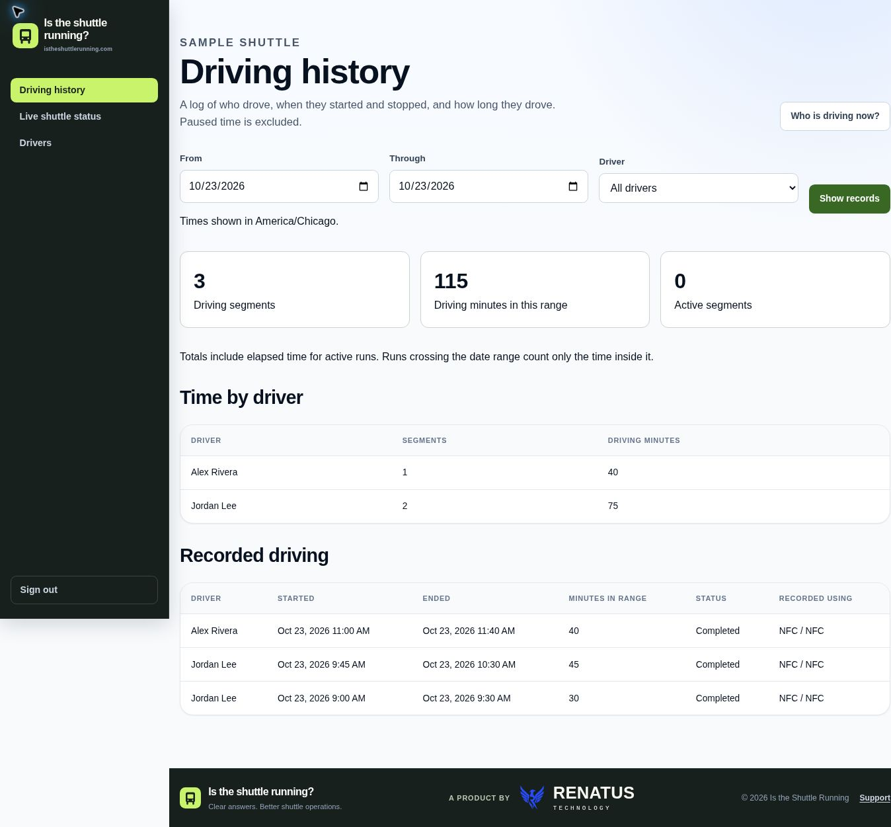

# Is the Shuttle Running?

[](https://github.com/victorpena210/is-the-shuttle-running/actions/workflows/routepulse-ci.yml)

A Java / Spring Boot application that gives riders a shared shuttle-status page,
drivers simple service controls, and managers a record of who drove and when.

**Built and maintained by Victor Peña at [Renatus Technology](https://renatus.technology).**
The project grew from firsthand experience with employee transportation and
wardrobe-counter staffing. It is an independent project; this repository does
not imply employer ownership or endorsement.

[Public website](https://istheshuttlerunning.com) ·
[Project story and engineering decisions](docs/project-story.md) ·
[Architecture](docs/architecture.md) ·
[Local setup](#local-development) · [Tests](#automated-tests)

## See the current application



[View rider and driver screens](docs/screenshots/README.md) ·
[Review the code and decisions](docs/project-story.md#a-short-code-review-path) ·
[Developer portfolio](https://victorpena210.github.io/#shuttle)

These application screens use fixed, fictional sample data rendered through
the Thymeleaf templates.

## The problem and the implementation

Riders need to know whether the shuttle is running. Drivers record actual
service at the shuttle checkpoint, and managers review who drove, when, and
for how long.

| Area | Implemented behavior |
| --- | --- |
| Riders | Public organization-specific pages showing running/not running and the active driver’s first name |
| Drivers | Role-restricted portal, NFC/QR checkpoint actions, start/resume, waiting, break, end controls, and read-only transportation demand |
| Managers | Driving history and totals, audited time corrections, four-hour session reviews, employee-schedule uploads, and driver suggestions based on availability and actual driving |
| Accounts | Organization-scoped access, invitations, email verification, password reset, and optional persistent sign-in |
| Operations | Versioned MySQL migrations, health probes, optional Sentry reporting, and backup/restore tooling |

**Current session behavior:** each driving session automatically ends after
four hours, or earlier when paused, ended, handed off, or closed by a manager.
The server checks every 30 seconds and records the end at the four-hour cutoff,
including overdue sessions found after a restart. Missing phone
location and inactivity do not automatically close sessions. Location sharing
is optional. Temporary manager status overrides still expire at their chosen
time.

Managers land on driving history at `/app` (`/driving-records` is an alias).
Sessions reaching the limit create a persistent in-app alert on manager pages,
refreshed every 30 seconds. `/driving-records/reviews` lists pending reviews across
all dates. Managers can approve the recorded cutoff or correct the start/end
with a reason, including verified driving beyond four hours. Every approval or
correction retains the prior times, reviewer, timestamp, and note. Corrections
update history and totals without reopening a closed session. Active forgotten
sessions can also be closed with corrected times. Driver access, cross-organization
changes, future end times, overlapping driver records, and stale edits are rejected.
Live status is at `/app/live-status`. Drivers use the
existing NFC/QR checkpoints to start, pause, resume, hand off, and end a run.
The public rider page at `/ride/{slug}` shows whether the shuttle is running
and the active driver’s first name.

**Employee transportation demand:** managers upload a Dayforce CSV or Excel (.xlsx) file at
`/transportation-demand`; drivers view the same organization’s aggregate counts at
`/driver/demand`. Every 15-minute interval shows scheduled clock-ins and clock-outs,
including quiet intervals, in Morning Arrivals (9 AM–noon), Midday Turnover
(noon–5 PM), and Evening Pickups (5 PM–11:59 PM). Off-hours are collapsed below.
The established noon rule is preserved: noon clock-ins belong to Morning and noon
clock-outs to Midday. Overnight departures appear on their actual calendar date.
These are schedule-based forecasts, not attendance or confirmed passenger counts.

The importer accepts short or full Dayforce column headings in any order, report
preambles, and quoted names. It skips employees without shifts, deduplicates exact
shift rows, and validates the complete file before changing counts. Re-uploading
replaces only the work dates present in that file, including their overnight
departures. The forecast stores anonymous counts with upload provenance for a
rolling 12 months. Only registered drivers’ matched work hours are saved separately,
with past work dates kept for 31 days; other employees’ rows are not saved. File size is
limited to 5 MB and 90 work dates per upload. Uploading or viewing demand does not
change live shuttle status or driving records.

**Suggested drivers:** the manager demand page recommends active roster members
whose uploaded work hours cover each full demand window. Employee IDs match exactly;
use **Edit employee ID** on `/drivers` to correct a match, then re-upload. Uploads
from before this feature need to be re-uploaded. Replacement files remove omitted
drivers from the included work dates and preserve all other dates.

Recommendations prioritize drivers who have not driven on the selected day, then
fewer actual driving seconds in the preceding 30 days, then longest since the last
session. They use corrected session times, union overlapping records, and cap open
sessions at four hours. Future previews use current history; past previews use
history before that date. Suggestions are independent windows, not reservations or
assignments. They never change actual sessions, live status, or the four-hour cutoff.

Opening service requires another distinct scheduled, active driver-roster member
at the wardrobe counter. Morning opening service lasts up to three hours; an
opening at noon or later runs until wardrobe closes. Other service waits until
closing. Saved wardrobe rules apply, with an afternoon-start roster supplying the
opening time when no explicit opening is set. Managers can edit the selected day's
opening and closing times directly on the demand page. The retired park-calendar
integration is not called. Confirm other duties and breaks before choosing a driver.

Suggestions and driving-history comparisons are manager-only; driver demand pages
continue to show aggregate employee demand. Availability gaps, unmatched drivers,
and ranked alternatives are visible to managers.

**Personal UKG calendars:** managers use **Drivers → UKG calendar** for each driver;
drivers use **My UKG calendar** to connect their own subscription. Cedar Fair UKG
links using `webcal://` or `https://` are read over HTTPS. Select Shifts only in
UKG's Sync My Schedule subscription. Each driver needs their own link. Refreshes
run about every 15 minutes, and a Refresh now button is available. The page shows
imported work hours, last refresh, and errors; it never displays the saved link.

For dates from the last successful sync onward, connected calendars take priority
over uploaded schedule availability. Empty days mean unavailable; dates beyond the six-week
subscription range are unknown. Failed refreshes keep the previous snapshot, but
availability is excluded after 24 hours without a successful sync. Disconnecting
removes the link and calendar snapshot and restores uploaded schedule availability. Calendar
sync changes neither workforce demand counts nor actual driving sessions.

Links are AES-256-GCM encrypted with a purpose-specific key derived from
`app.calendar.encryption-key`, falling back to the existing stable remember-me
secret. Set a dedicated stable key with `APP_CALENDAR_ENCRYPTION_KEY` if desired.
Changing the encryption secret requires reconnecting calendars. Local development
with a random remember-me key cannot retain usable connections across restarts.
HTTP destinations are restricted to the Cedar Fair UKG calendar endpoint, redirects
are disabled, and response size and read/connect times are bounded. Only shift
start/end times are retained; feed descriptions, names and UIDs are not stored.


## Stack and code tour

- Java 17, Spring Boot 4.1.0, Spring MVC, Spring Security, and Thymeleaf.
- Spring Data JPA, MySQL, and Flyway migrations.
- HTML, CSS, and browser JavaScript; no frontend framework required.
- JUnit, Mockito, MySQL Testcontainers, and Node's built-in test runner.
- Docker packaging and GitHub Actions CI.

Java code is organized by feature under
`src/main/java/technology/renatus/routepulse/`. Start with `driving/` for session
lifecycle and rider status, `organization/` for access boundaries, and
`reporting/workload/` for actual driving history. See [architecture](docs/architecture.md) and
[frontend organization](FRONTEND_ORGANIZATION.md) for the full map.

The former name **RoutePulse** remains in Java packages, artifact names, and
some configuration variables to preserve compatibility. The application entry
point is `technology.renatus.routepulse.RoutePulseApplication`; the built JAR is
`target/routepulse-0.0.1-SNAPSHOT.jar`.

## Local development

Requirements: Java 17 and MySQL 8.4 (or compatible). The executable Maven
wrapper downloads Maven. Docker is required for the integration tests, and
Node.js 22 is used for browser-script tests.

Create a dedicated local database:

```sql
CREATE DATABASE shuttleflow
    CHARACTER SET utf8mb4
    COLLATE utf8mb4_0900_ai_ci;
CREATE USER IF NOT EXISTS 'shuttleflow_admin'@'localhost'
    IDENTIFIED BY 'choose-a-local-password';
GRANT ALL PRIVILEGES ON shuttleflow.* TO 'shuttleflow_admin'@'localhost';
FLUSH PRIVILEGES;
```

From the repository root:

```bash
export DB_PASSWORD='choose-a-local-password'
export SPRING_PROFILES_ACTIVE=dev
./mvnw spring-boot:run
```

Self-service organization registration is removed; `/register` and
`/organization/register` return HTTP 410 for page requests and form submissions.
Use an existing authorized account or an organization invitation to sign in at
<http://localhost:8080/login>. The automated tests below create isolated local
organizations and fictional users. Development invitation, verification, and
password-reset links appear in the application console instead of being emailed.
Never use real employee exports for a public demonstration.

[.env.example](.env.example) documents configuration names and placeholders;
Spring Boot does not automatically load that file. Set values in your shell,
IDE, container environment, or hosting settings. Do not commit local secrets.

## Automated tests

With Docker running:

```bash
node --test src/test/js/*.test.cjs
./mvnw clean verify
```

Testcontainers starts a temporary MySQL 8.4 instance and applies the migrations
to a blank database. Tests cover authentication, organization isolation,
imports, staffing, session lifecycle, and template behavior. CI runs the same
JavaScript and Maven checks, then builds the production Docker image.

For a focused set of unit/template checks without Docker:

```bash
./mvnw -Dtest=DrivingHistoryTests,PublicRiderStatusTests,SimpleDrivingScreensTests,DriverCheckpointServiceTests test
node --test src/test/js/*.test.cjs
```

Current-workflow tests cover independent driving sessions, stale checkpoint
actions, handoffs, organization isolation, date boundaries, and the minimal
rider page. Retained legacy planning tests also use a controlled calendar.
The CI badge shows the latest workflow result; it is not a claim about the
currently deployed service.

## Production configuration

| Variable | Required | Purpose |
| --- | --- | --- |
| `SPRING_PROFILES_ACTIVE=prod` | Yes | Enables production settings and SMTP delivery |
| `DB_URL` | Yes | Production MySQL JDBC URL |
| `DB_USERNAME` | Yes | Production database user |
| `DB_PASSWORD` | Yes | Production database password |
| `APP_BASE_URL` | Yes | Public HTTPS origin used in emailed links |
| `REMEMBER_ME_KEY` | Yes | Stable private signing key; generate with `openssl rand -hex 32` |
| `REMEMBER_ME_DAYS` | No | Persistent sign-in lifetime; defaults to `90` |
| `MAIL_HOST` | Yes | SMTP hostname |
| `MAIL_PORT` | No | SMTP port; defaults to `587` |
| `MAIL_USERNAME` | Yes | SMTP username |
| `MAIL_PASSWORD` | Yes | SMTP password |
| `MAIL_FROM` | Yes | Verified sender address |
| `DEMO_REQUEST_RECIPIENT` | No | Business inbox receiving demo requests |
| `SENTRY_DSN` | No | Enables error reporting; blank disables Sentry |
| `SENTRY_ENVIRONMENT` | No | Defaults to `production` in the prod profile |
| `SENTRY_RELEASE` | No | Deployment identifier for error correlation |
| `SENTRY_ERROR_SAMPLE_RATE` | No | Defaults to `1.0` |
| `SENTRY_TRACES_SAMPLE_RATE` | No | Defaults to `0.0` |
| `PORT` | No | Web port; defaults to `8080` |

Set credentials only in the application host's secret/environment settings.
Keep `REMEMBER_ME_KEY` stable across deployments. The old
`RIDER_CONFIRMATION_MINUTES` and `RIDER_OVERRUN_GRACE_MINUTES` settings are ignored.

The uptime workflow defaults to `https://istheshuttlerunning.com` in this
repository. The optional GitHub Actions variable `ROUTEPULSE_PRODUCTION_URL`
overrides that origin. Forks must set their own URL to opt in. GitHub's scheduled
runs may be delayed, so the five-minute cron is not a guaranteed polling SLA.
See [monitoring and recovery](docs/production-monitoring-and-recovery.md).

Before deploying, require passing CI, configure production secrets, verify
`/actuator/health/readiness`, and exercise login, invitations, driver controls,
and rider status. Keep registration restricted to authorized participants.
Verify database backups with an isolated restore drill. This repository does
not establish that a particular host's backups or Sentry alerts are configured.

## Data handling and maintenance

Use fictional people and schedules in examples. Raw employee schedule retention,
registered driver records, and backup retention are separate concerns; see
[privacy cleanup and history handling](PRIVACY_CLEANUP.md) and
[security reporting](SECURITY.md).

Never edit a Flyway migration after it has run against a shared or production
database. Add the next numbered migration instead. Historical migrations V2,
V3, and V10 were sanitized during early development; an old local database may
need the development-only reset described in `PRIVACY_CLEANUP.md`.

Additional references: [NFC setup](docs/NFC-SETUP.md),
[wardrobe hours](docs/wardrobe-opening-hours.md), and
[rebrand history](docs/REBRAND.md). Dated update notes describe earlier changes;
the current code and the session behavior above take precedence.

Excel schedule uploads use the same columns and validation as CSV. Native Excel date/time cells (1900 or 1904 dates), text dates, leading-zero employee ID formats, report preambles, and multiple schedule worksheets are supported. Duplicate shifts across worksheets count once. Use values rather than formulas. Upload limits: 5 MB compressed, 20 MB expanded for XLSX, 50,000 rows, 128 columns, and 90 work dates. Invalid uploads preserve the existing forecast and driver hours.

UKG “Employee Schedule - Weekly” grids import transportation demand for all named people and all seven reported dates, including explicit zero-demand days. First start and final end per employee/day determine transport counts; meal-break continuations remain separate availability segments for registered drivers. Driver matching uses a unique full roster name within the current organization (case/spacing normalized); unmatched employees still count toward demand, while ambiguous roster matches reject the upload. Re-uploading replaces demand for the reported dates and availability only for named matched drivers. Reports must include everyone intended for the demand count. Connected UKG calendars retain priority.
