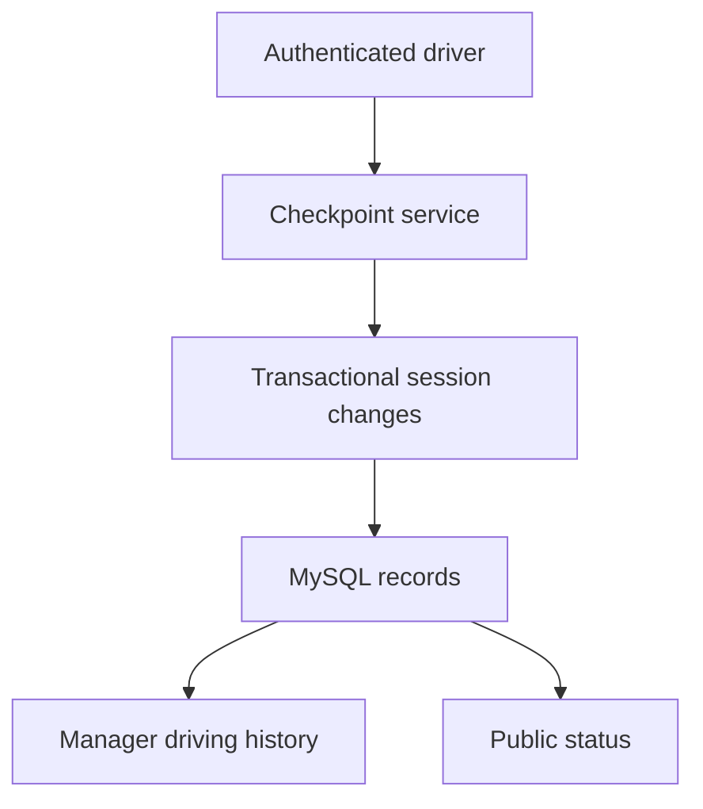

# Is the Shuttle Running? architecture

Java 17, Spring Boot, Spring MVC, Spring Security, Thymeleaf, Spring Data JPA,
MySQL, and Flyway form one server-rendered application. The entry point remains
`technology.renatus.routepulse.RoutePulseApplication`; the Maven artifact remains
`routepulse` for compatibility. Updated October 23, 2026 for the driving-log workflow.

## Current request paths

| Request | Controller and service | Result |
| --- | --- | --- |
| `/driver` | `DriverPortalController` → `DriverPortalService` | Current run and the driver's recent history |
| `/driver/tap`, `/driver/scan` | `DriverPortalController` → `DriverCheckpointService` → `DrivingSessionService` | Authenticated NFC/QR start, pause, end, or handoff |
| `/app`, `/driving-records` | `DrivingRecordController` → `ActualDrivingRecordService` | Organization-scoped date/driver filters and actual time totals |
| `/app/live-status` | `DashboardController` → `RiderStatusService`, `OperationalStatusService` | Manager status controls and active-run correction |
| `/ride/{slug}` | `RiderStatusController` → `RiderStatusService` | Public running/not-running status and driver's first name |

## Session lifecycle and concurrency

A checkpoint validates the current user, active driver, organization, and tag code.
The service locks the organization and reads the active session for update before
choosing an action. With no active run, a confirmed start creates an independent
session. The current driver can pause or end it; another driver must explicitly
confirm a handoff. Stale actions fail instead of silently changing another run.

Pausing ends a segment; resuming starts another. Handoffs close the previous
segment and open the next in the same transaction. A manager can close a forgotten
run with its actual end time. Phone inactivity and missing GPS do not end runs.

`DrivingSession` stores the organization, actual driver, timestamps, initiating and
ending users, checkpoint methods, and end reason. Its optional assignment link
preserves older records. New runs do not require an assignment or work schedule.
The active-session model is per organization, not per vehicle.

## Reporting and time

`ActualDrivingRecordService` loads overlapping sessions for the authenticated
organization and validates an optional driver against that organization. Date
boundaries are calculated in the configured operations timezone and converted
to instants. Each segment is clipped to the selected interval; active segments
use the current time. Driver totals aggregate seconds before displaying minutes.
Pauses occupy no segment and therefore add no driving time.

## Public status

`RiderStatusService` combines recorded activity with unexpired manager overrides.
`RiderStatusController` exposes only organization name, a boolean running state,
and the active driver's first name. Waiting and ending-soon states count as
running; paused, delayed, unavailable, unconfirmed, and stopped states do not.
The page refreshes every 20 seconds and responses disallow caching.

Public ride-confirmation POSTs and passenger-QR requests return HTTP 410.
Operational notes, pickup instructions, schedules, and passenger confirmations
are not rendered on the public page. Internal legacy fields remain for compatibility.

## Access and persistence

Spring Security protects role-restricted routes and CSRF-protected actions.
Organization-aware services validate membership and resource ownership.
`OrganizationActorService` centralizes checks for audited changes;
`DriverPortalAccessService` validates driver checkpoints. Invitations, email
verification, password resets, and persistent sign-in remain supported.

Flyway owns the versioned database schema in `src/main/resources/db/migration`.
Do not rewrite applied migrations. This simplification adds no migration and
preserves existing accounts, tag codes, and driving history. Credentials and
hosting settings remain external configuration; see `.env.example` and README.

## Feature map

Paths are relative to `src/main/java/technology/renatus/routepulse/`.

| Package | Current responsibility |
| --- | --- |
| `auth/`, `organization/` | Accounts, invitations, membership and access checks |
| `driver/` | Driver registration, portal and physical checkpoints |
| `driving/` | Actual sessions, manual controls, optional movement data and rider status |
| `reporting/workload/` | Actual history through `ActualDrivingRecordService`; older report services are legacy |
| `dashboard/`, `operations/` | Live status, temporary overrides and run corrections |
| `shared/` | Security, throttling, common web support and retired-route interception |
| `marketing/` | Landing page and demo requests |
| `scheduling/`, `assignments/`, `calendar/`, `wardrobe/` | Retained planning implementation and historical compatibility |

## Retired functionality

`RetiredPlanningRoutes` intercepts schedule imports, assignment edits, availability,
calendar and wardrobe planning, and older planning reports. Reads redirect to the
current workflow and writes return HTTP 410 before the old handlers run. The
retention/forecasting job and availability notices are no longer registered as
active components. Historical planning services and tests remain in the repository;
the current dashboard does not call `DashboardPlanningService`.

The historical calendar adapter, scheduling documents, and old walkthrough are
useful records of earlier iterations, not descriptions of current product features.
See [the scope decision](project-story.md#why-the-scope-changed).

## Verification

Run `node --test src/test/js/*.test.cjs` and `./mvnw clean verify` with Docker.
GitHub Actions runs those checks and builds the production Docker image.
The shared MySQL Testcontainers fixture applies migrations to a temporary database;
integration methods roll back their test data.

Review `DriverCheckpointServiceTests`, `UnscheduledDrivingIntegrationTests`,
`OrganizationIsolationIntegrationTests`, `ActualDrivingRecordServiceTests`,
`DrivingHistoryTests`, and `PublicRiderStatusTests` for the current workflow.
Legacy planning tests remain regression coverage for retained source. A passing
CI build verifies its commit; it does not alone establish production deployment.
