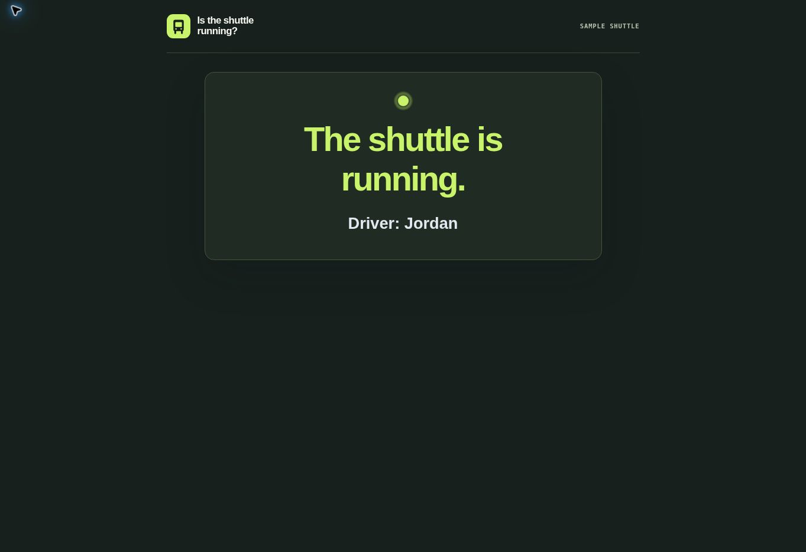
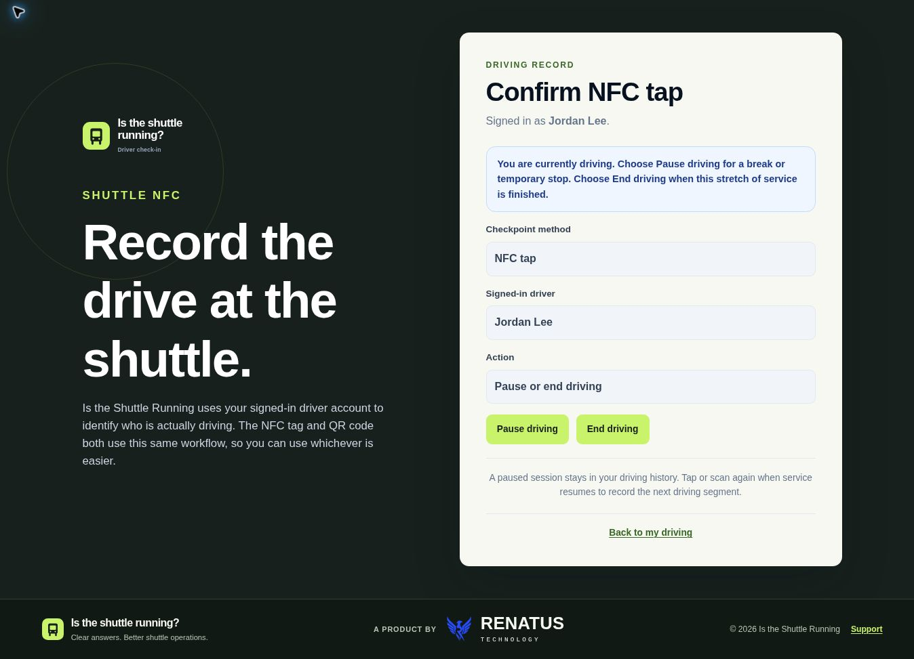

# Current application screens

These images show the current Thymeleaf templates rendered with fixed fictional
records on October 23, 2026. Sample Shuttle, Jordan Lee, and Alex Rivera are example
data. The screens illustrate separate states; they are not a synchronized live
operation, production account, or evidence of product adoption.

## Rider status

The public view shows running/not running and the active driver's first name.
It contains no schedule or ride-confirmation control.



## Driver checkpoint

The authenticated NFC/QR workflow records actual session changes. This example
shows the active driver's pause and end controls.



## Manager history

Actual segments, selected-range totals, and per-driver totals. The 115-minute
sample consists of three completed segments; the gap between Jordan's runs adds
no driving time.


## Reproduce the fixtures

From the repository root, with Java 17 and Maven dependencies available:

```bash
./mvnw -DskipTests test-compile dependency:build-classpath -Dmdep.includeScope=test -Dmdep.outputFile=target/portfolio-classpath.txt
java -cp "target/classes:target/test-classes:$(cat target/portfolio-classpath.txt)" scripts/RenderPortfolioScreens.java target/portfolio-screens
cp -R src/main/resources/static/css src/main/resources/static/images target/portfolio-screens/
python3 -m http.server 8000 --directory target/portfolio-screens
```

Open `http://localhost:8000/rider.html`, `/driver.html`, and `/history.html` in a
browser and capture the rendered pages. The colon-separated classpath above is
for macOS/Linux; use a semicolon separator on Windows.

The fixture renderer uses the existing test web context and these real templates:

- `src/main/resources/templates/public/rider-status.html`
- `src/main/resources/templates/driver/scan.html`
- `src/main/resources/templates/manager/driving-records.html`

No database, real accounts, or valid checkpoint secrets are used. These static
fixtures do not implement navigation or submissions and are not a runnable demo.
For application setup and full checks, follow the [repository README](../../README.md).
